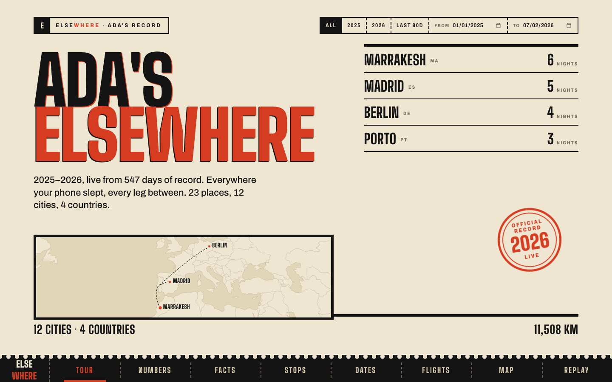
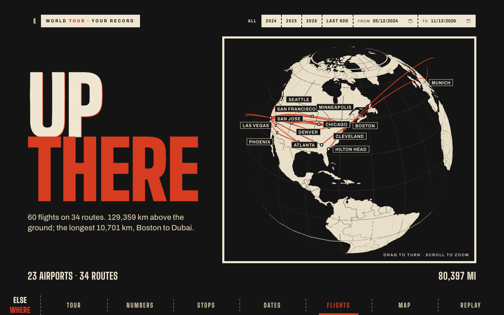
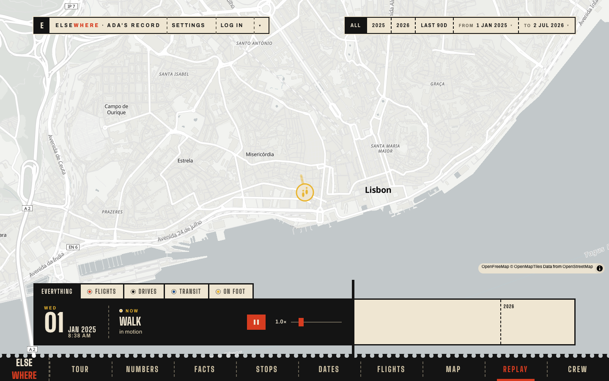

<h1 align="center">Elsewhere</h1>
<p align="center"><strong>Your Google Maps Timeline, printed as a world-tour poster.</strong><br>
Every city you slept in, every flight, every drive — replayed on a map. Runs entirely in your browser.</p>

<p align="center">
<a href="#quick-start">Quick start</a> ·
<a href="#what-you-get">What you get</a> ·
<a href="#your-data-and-what-it-costs">Privacy & cost</a> ·
<a href="#deploy-your-own">Deploy</a> ·
<a href="#android">Android</a> ·
<a href="#develop">Develop</a>
</p>

<p align="center"></p>

## Quick start

> New here? **[SETUP.md](SETUP.md)** walks through everything — export, web, Android, and the optional Google key — in plain language.

```bash
git clone https://github.com/vsvinav/elsewhere && cd elsewhere/web
npm install && npm run dev
```

Open the local URL and follow the front door:

| Step | What to do | Why |
| --- | --- | --- |
| 1 | **Export your Timeline** — see [Getting your export](#getting-your-export) below. | It's the only input. |
| 2 | **Drop `Timeline.json` on the card.** | Parsed in your browser, kept in local storage. Nothing is uploaded. |
| 3 | **Paste a Google Maps key** (optional, free tier is plenty). | Draws Google tiles and names your busiest stops. Without it, maps fall back to OpenStreetMap. |
| 4 | **Answer five questions** — name, home (and earlier homes), work, units. | Trips, nights away and distances all start from *your* home, not Google's guess. |

Everything can be changed later from the ▾ menu by the masthead, which also starts you over.

### Getting your export

- **Android** — Settings → Location → Location Services → Timeline → *Export Timeline data*.
- **iPhone** — Google Maps → your photo → *Your timeline* → ⋯ → *Export*.
- Either way you get one `Timeline.json`. Big records (several years) take a few seconds to parse.

> Google moved Timeline onto the phone in 2024. Takeout no longer includes it; use the in-app export above.

### Getting a Google Maps key

1. Open [console.cloud.google.com → Maps APIs](https://console.cloud.google.com/google/maps-apis).
2. Enable **Maps JavaScript API** and **Places API (New)**.
3. Create a key and restrict it to `http://localhost:*` and your domain.
4. Optional: create a **Map ID** with a vector style for crisper tiles; paste it alongside the key.

## What you get

| Tab | What's on it |
| --- | --- |
| **Tour** | Your years as one poster: cities ranked by nights slept, places, countries, a dotted route map. |
| **Numbers** | Distance by month and mode, best month, the long-run averages. |
| **Facts** | Eighteen things your record says about you, each with a figure, plus a turning card of shorter, ruder ones. |
| **Stops** | The places you keep going back to, with photos and names. |
| **Dates** | A calendar of where you were, night by night. |
| **Flights** | A globe turned to show every route, airports labelled, distance totalled; pick an airport to see where it took you. |
| **Map** | Every stop pinned, clustered as you zoom out, filtered by category, searchable, sized by visits or hours. |
| **Replay** | Press play and move through time. Planes, cars, trains and walks each get their own colour and marker; the camera frames each leg whole. |

Pick any range — a year, the last 90 days, two dates from the calendar — and every tab updates. Each card saves as a PNG, framed for a story or a post.

## What's new in v2 (preview)

v2 is being built on the `v2` branch and published as a preview at **https://vsvinav.github.io/elsewhere/v2/** (the root URL stays on v1). Android gets a matching APK per release, tagged `v2.0.0-alpha.N`. Where to find each addition:

| Feature | What it does | Web | Android |
| --- | --- | --- | --- |
| **Year wheel** | Spin a dial of years to re-range the whole record. | Tour, under the headline. | Tour hero. |
| **Highlights** | A full-width "On this day" card: where you were on today's date in earlier years. | Facts, at the top. | Facts, at the top. |
| **Fun Facts hero** | The rotating deck of shorter, ruder facts, with ←/→, Shuffle and kind chips. | Facts, below Highlights. | Facts — swipe the deck. |
| **Play strip** | Five small games off your record (streaks, records, "earlier this year"…). | Facts, the PLAY strip. | Facts, the PLAY strip. |
| **Passport** | Stamps per country, printed as a passport page. | Facts, bottom of the page (the deck's "Passport" card jumps there). | Facts, bottom. |
| **Doors** | Tap any month or figure to open the Dates behind it; the back button returns you. | Numbers → month bars and *door to door*; Dates. | Same. |
| **Trip deck** | Each trip as a card you can open, swipe and share. | Dates. | Dates. |
| **Heat** | A density layer of where you go most. | Map → **HEAT** chip. | Map → **HEAT** chip. |
| **Live now** | Your current position and a pulsing stamp while recording. | — (no recorder in the browser) | Map → **LIVE** chip while *Record on this phone* is running. |
| **Snap a place** | Attach a photo to a stop; it shows on the stop's card. | Stops → open a stop → **Snap**. | Stops → open a stop → **SNAP** stamp. |
| **Globe share** | Share the Flights globe as a card. | Flights → Save. | Flights → Save. |
| **Settings** | One page for keys, units, Ask Elsewhere, Crew relay, and clearing data. | **Settings** chip by the masthead, or ▾ → Settings (`#settings`). | ▾ (the **E**) → Settings. |
| **Crew** | Pair with friends by code or QR; opt in per friend to *Live · city*, *Live · precise* and *Sonar*. | ▾ → **Crew** (`#crew`). Friends' stamps appear on the Map. | ▾ → **Crew**; Map → **Share** to broadcast while recording. |
| **Sonar** | Pings you both when you and a friend are within a mile and neither of you is usually there. | Rings and a tone on the Map. | Rings on the Map and a notification. |
| **Accounts** | Sign up with an email code; a passphrase-sealed vault carries your profile and Crew identity to a new device. The record itself never leaves the device. | Welcome screen on first open; **Settings → Account**. | Welcome screen on first open; Settings → Account. |

### Setting up Crew and Sonar

Crew needs a relay — a tiny Cloudflare Worker in [`relay/`](relay/) that holds device ids and **encrypted** pings only (it can't read locations). Deploy it once on the free tier:

```bash
cd relay && npm ci && npx wrangler login && npx wrangler deploy   # prints https://….workers.dev
```

Paste that URL into **Settings → Crew → Relay URL** on every device, then:

1. **Pair.** On one device open Crew and read the code (`PT-XXX-XXXX`; Android can also show a QR). On the other, type it under *Enter a friend's code* (or scan). Both see "Pair with *name*?" with an 8-character fingerprint — check they match, then confirm.
2. **Share.** Toggle *Live · city* or *Live · precise* for that friend. Android broadcasts while **Record on this phone** is running (Map → **Share**); the browser only receives, since it has no recorder.
3. **Sonar.** Toggle *Sonar* for the friend (it also turns on *Live · city*). It fires only when you are both within a mile, both away from the places you usually are, after at least 14 days away, once per 24 hours — so two phones on the same desk at home will stay quiet by design.

Leaving the Relay URL empty turns Crew off. Removing a friend tells their device to remove you too.

### Running the account service

Accounts need a second small Worker in [`account/`](account/): it mails six-digit codes, keeps sessions, and stores one **encrypted** vault per account that only your passphrase opens (the service never sees the key). Create a KV namespace, put its id in `account/wrangler.toml`, set the mail secrets and deploy:

```bash
cd account && npm ci && npx wrangler login && npx wrangler kv namespace create ACCOUNTS
npx wrangler secret put RESEND_KEY && npx wrangler secret put MAIL_FROM && npx wrangler secret put LINK_BASE
npx wrangler deploy   # prints https://….workers.dev
```

Paste that URL into **Settings → Account → Account service URL**. For local work set `DEV_MAIL = "1"` in `wrangler.toml` and the code comes back in the response instead of a mail.

<p align="center">


</p>
<p align="center">


</p>

Screenshots show the demo record: Ada, eighteen months in Lisbon with four trips out. Build it with `python3 scripts/make_sample.py --out web/public/data` (see [Pre-bake with Python](#optional-pre-bake-a-record-with-python)).

## Your data, and what it costs

Your export never leaves your machine. It is parsed in the browser and kept in local storage. The only network calls are map tiles, a handful of free OpenStreetMap address lookups for your home picks, and — only with your key — Google Places names and photos for your hundred busiest stops. The ▾ menu shows a running count of paid calls and a rough dollar figure.

| Feature | Source | Paid? |
| --- | --- | --- |
| Parsing, stats, facts, tour, dates | your export, in the browser | no |
| Street addresses for home/work picks | OpenStreetMap Nominatim | no |
| Photos of landmarks, stations, hotels Google has none for | Wikimedia Commons | no |
| Map tiles | Google Maps JS, falling back to OpenFreeMap | 1 map load per visit |
| Names, types, photos for your 100 busiest stops | Google Places Details, cached forever | ≤100 Pro calls, once |
| Place photos | Google Place Photos, loaded only when shown | ~$7 per 1,000 past free |

Google's monthly free allowance is roughly 5,000 Pro calls and 10,000 map loads; a personal install stays well inside it. When Google refuses a key, maps fall back to OpenStreetMap automatically.

## Deploy your own

**GitHub Pages (built in).** Fork, then in *Settings → Pages* set the source to *GitHub Actions*. Add two repository secrets — `VITE_GOOGLE_MAPS_KEY` and, optionally, `VITE_GOOGLE_MAP_ID` — and push to `main`. The site publishes at `https://<you>.github.io/elsewhere/` and opens on the import screen; no record is bundled.

**Anywhere else.**

```bash
cd web && npm run build   # → web/dist, a static site
```

Host `dist/` on Netlify, Vercel, S3 — anything static. To ship a default key for visitors, put `VITE_GOOGLE_MAPS_KEY=…` in `web/.env.local` (gitignored) before building, and restrict that key to your domain.

## Android

A native Android app with the same tabs and the same poster is being built in its own repository: [vsvinav/elsewhere-android](https://github.com/vsvinav/elsewhere-android).

## Optional: pre-bake a record with Python

The browser import is all you need. If you'd rather build the data files once and serve them (for a kiosk, or to name thousands of places with the Places API), there's a pipeline:

```bash
python3 -m venv .venv && source .venv/bin/activate && pip install -e ".[dev]"
python -m pipeline build Timeline.json --home LAT,LNG        # → web/public/data/
#   repeat --home LAT,LNG,YYYY-MM[,YYYY-MM] for each move (start, optional end); add --work LAT,LNG if you like
GOOGLE_MAPS_API_KEY=… python -m pipeline enrich --top 2000  # optional place names + photos
```

## Develop

```bash
cd web
npm run dev        # Vite dev server
npm test           # vitest
npx tsc --noEmit   # types
```

```
web/src
├── ingest/      parse Timeline.json, name places (Google, Nominatim, Wikimedia), cost gating
├── analytics/   trips, nights, facts, flights, geo — pure functions, all tested
├── map/         deck.gl layers, clustering, replay camera and springs
├── tabs/        one folder per tab
├── world/       the design system: Pass, Bill, Sticker, figures, world.css
└── profile/     onboarding and the stored profile
pipeline/        the optional Python pre-bake
```

## Built with

React 19 · Vite · deck.gl on Google Maps (MapLibre fallback) · d3-geo for the globe · Big Shoulders Display & Archivo.
