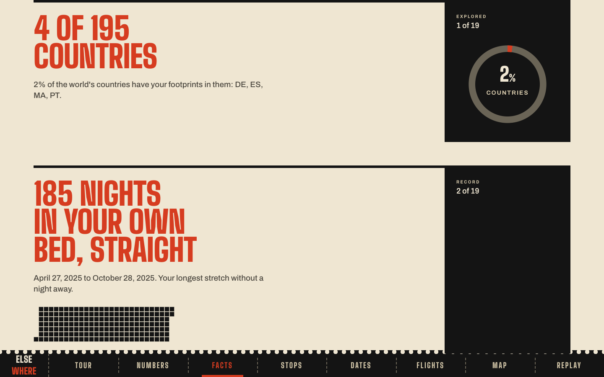

<h1 align="center">Elsewhere</h1>
<p align="center"><strong>Your Google Maps Timeline, printed as a world-tour poster.</strong><br>
Every city you slept in, every flight, every drive — replayed on a map. Runs entirely in your browser.</p>

<p align="center"></p>

## What you get

- **Tour** — your years in one poster: cities ranked by nights slept, places, countries, a route map.
- **Flights** — a globe turned to show every route you've flown, airports labelled, distance totalled; pick an airport to see where it took you.
- **Facts** — nineteen things your record says about you, each with a figure, each shareable as text.
- **Replay** — press play and watch yourself move through time. Planes, cars, trains and walks each get their own colour and marker; a speed slider goes from real-time to years-in-seconds.
- **Stops, Dates, Numbers, Map** — the places you keep returning to, a calendar of where you were, the stats, and the full trail.
- **Pick any range** — a year, the last 90 days, or any two dates. Everything updates.
- **Yours, not guessed** — a one-minute setup asks your name, where home is (and was), and where you work. Trips, nights away and distances all start from *your* home, not Google's guess.

<p align="center">


</p>
<p align="center">


</p>

Screenshots show the demo record: Ada, eighteen months in Lisbon with four trips out. Make it yourself with `python3 scripts/make_sample.py --out web/public/data` (needs the Python setup below).

Your data never leaves your machine. The export is parsed in the browser and kept in local storage; the only network calls are Google's map tiles.

## Run it

```bash
git clone https://github.com/vsvinav/elsewhere && cd elsewhere/web
npm install && npm run dev
```

Open the local URL. The front door asks for two things, then five quick questions:

1. **Drop in your `Timeline.json`.**
   Android: Settings → Location → Timeline → Export.
   iPhone: Google Maps → your photo → Your timeline → ⋯ → Export.
2. **Paste a Google Maps key** (free tier is plenty) so the Map and Replay pages can draw tiles. Get one at [console.cloud.google.com](https://console.cloud.google.com/google/maps-apis), enable *Maps JavaScript API*, and restrict it to `localhost` / your domain.
3. **Name, home, moves, work, units.** Home candidates are ranked by where your phone sleeps; tap one. Every question can be changed later from the ▾ menu by the masthead, which also starts you over.

Everything lives in your browser's local storage. Nothing is committed, nothing is uploaded.

## Deploy your own

```bash
npm run build          # → web/dist, a static site
```

Host `dist/` anywhere (GitHub Pages, Netlify, Vercel). To ship a default key for visitors, put `VITE_GOOGLE_MAPS_KEY=…` in `web/.env.local` (gitignored) before building — and restrict that key to your domain.

## Optional: pre-bake a record with Python

The browser import is all you need. If you'd rather build the data files once and serve them (or name places with the Places API), there's a pipeline:

```bash
python3 -m venv .venv && source .venv/bin/activate && pip install -e ".[dev]"
python -m pipeline build Timeline.json --home LAT,LNG        # → web/public/data/
#   repeat --home LAT,LNG,YYYY-MM for each move; add --work LAT,LNG if you like
GOOGLE_MAPS_API_KEY=… python -m pipeline enrich --top 2000  # optional place names + photos
```

## Built with

React 19 · Vite · deck.gl on Google Maps · d3-geo for the globe · Big Shoulders Display & Archivo.

Design notes live in [`docs/superpowers/specs`](docs/superpowers/specs).
