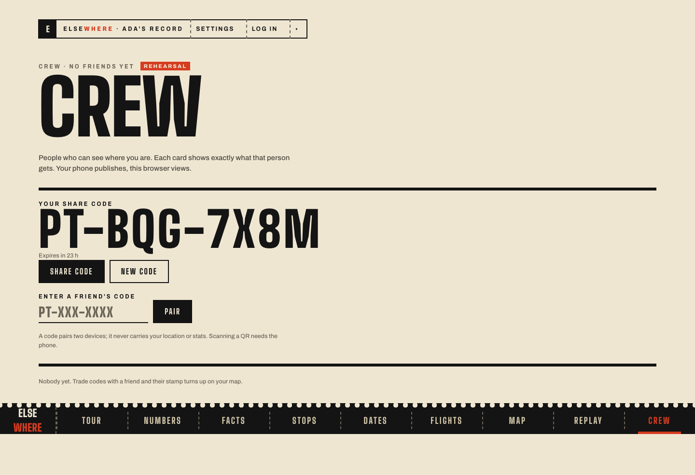
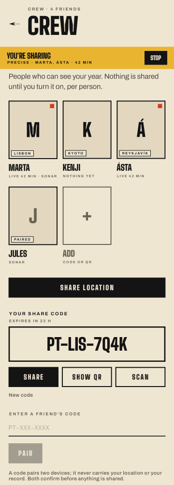
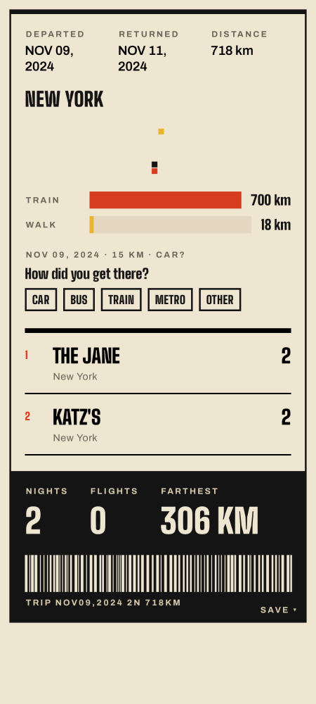
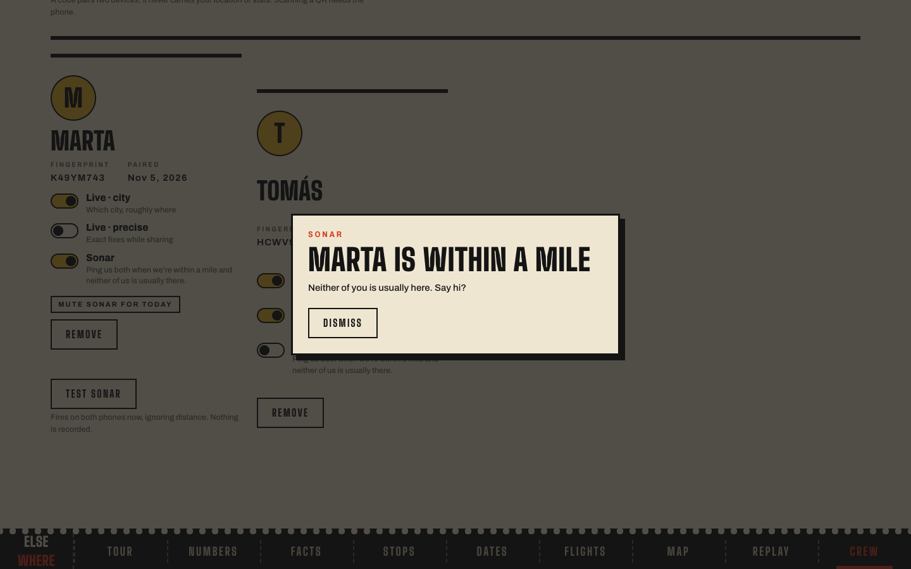
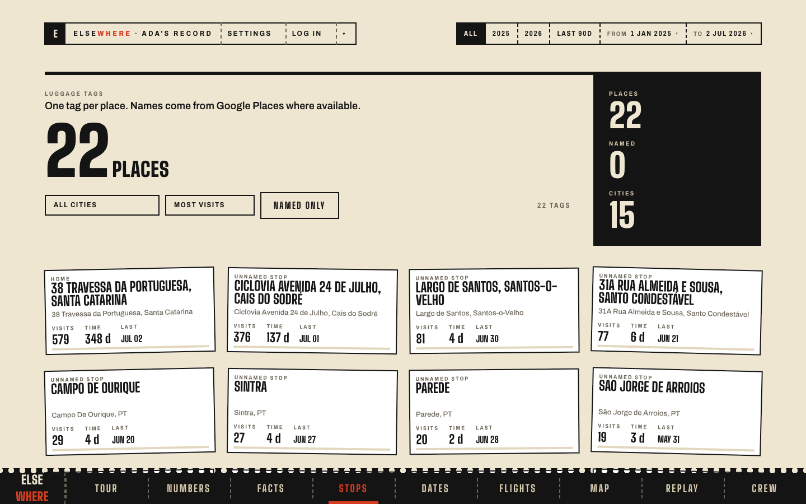
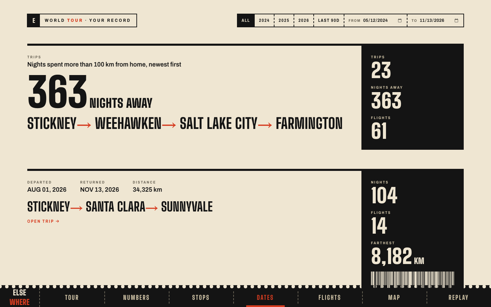
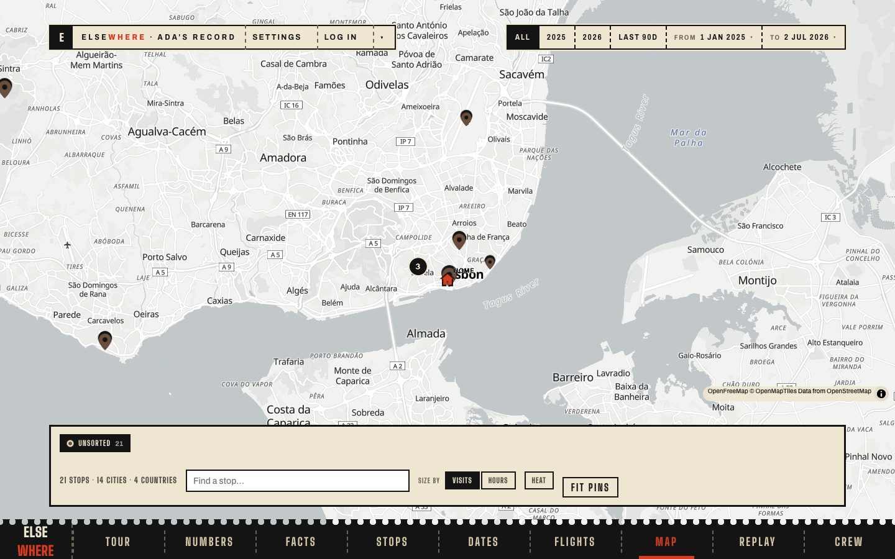

<h1 align="center">Elsewhere</h1>
<p align="center"><strong>Your Google Maps Timeline, printed as a world-tour poster.</strong><br>
Every city you slept in, every flight, every drive — replayed on a map. Runs in your browser, or records as you go on Android.</p>

<p align="center">
<a href="#quick-start">Quick start</a> ·
<a href="#what-you-get">What you get</a> ·
<a href="#crew-and-sonar-step-by-step">Crew & Sonar</a> ·
<a href="#your-data-and-what-it-costs">Privacy & cost</a> ·
<a href="#deploy-your-own">Deploy</a> ·
<a href="#android">Android</a> ·
<a href="#develop">Develop</a>
</p>

<p align="center"></p>

## Quick start

> New here? **[SETUP.md](SETUP.md)** walks through everything — export, web, Android, and the optional Google key — in plain language.

```bash
git clone https://github.com/vsvinav/elsewhere && cd elsewhere/web
npm install && npm run dev
```

Open the local URL and follow the front door:

| Step | What to do | Why |
| --- | --- | --- |
| 1 | **Export your Timeline** — see [Getting your export](#getting-your-export) below. | It's the only input. |
| 2 | **Drop `Timeline.json` on the card.** | Parsed in your browser, kept in local storage. Nothing is uploaded. |
| 3 | **Paste a Google Maps key** (optional, free tier is plenty). | Draws Google tiles and names your busiest stops. Without it, maps fall back to OpenStreetMap. |
| 4 | **Answer five questions** — name, home (and earlier homes), work, units. | Trips, nights away and distances all start from *your* home, not Google's guess. |

Everything can be changed later from the ▾ menu by the masthead, which also starts you over.

### Getting your export

- **Android** — Settings → Location → Location Services → Timeline → *Export Timeline data*.
- **iPhone** — Google Maps → your photo → *Your timeline* → ⋯ → *Export*.
- Either way you get one `Timeline.json`. Big records (several years) take a few seconds to parse.

> Google moved Timeline onto the phone in 2024. Takeout no longer includes it; use the in-app export above.

### Getting a Google Maps key

1. Open [console.cloud.google.com → Maps APIs](https://console.cloud.google.com/google/maps-apis).
2. Enable **Maps JavaScript API** and **Places API (New)**.
3. Create a key and restrict it to `http://localhost:*` and your domain.
4. Optional: create a **Map ID** with a vector style for crisper tiles; paste it alongside the key.

## What you get

| Tab | What's on it |
| --- | --- |
| **Tour** | Your years as one poster: cities ranked by nights slept, places, countries, a dotted route map. |
| **Numbers** | Distance by month and mode, best month, the long-run averages. |
| **Facts** | Eighteen things your record says about you, each with a figure, plus a turning card of shorter, ruder ones. |
| **Stops** | The places you keep going back to, with photos, names and street addresses. |
| **Dates** | A calendar of where you were, night by night, with a ticket per trip and the mode of every leg. |
| **Flights** | A globe turned to show every route, airports labelled, distance totalled; pick an airport to see where it took you. |
| **Map** | Every stop pinned, clustered as you zoom out, filtered by category, searchable, sized by visits or hours. |
| **Replay** | Press play and move through time. Planes, cars, trains and walks each get their own colour and marker; the camera frames each leg whole. |
| **Crew** | Friends who can see your city, and Sonar — see [Crew and Sonar, step by step](#crew-and-sonar-step-by-step). |

Pick any range — a year, the last 90 days, two dates from the calendar — and every tab updates. Each card saves as a PNG, framed for a story or a post.

## What's new in v3

v3 lives on the `v3` branch and is published at **https://vsvinav.github.io/elsewhere/v3/**. Android gets a matching APK per release, tagged `v3.0.0-alpha.N`, from [vsvinav/elsewhere-android](https://github.com/vsvinav/elsewhere-android/releases). Both clients share every feature and the same poster; the one deliberate difference is that the browser has no recorder, so it *views* Crew and Sonar while the phone *publishes*.

| Feature | What it does | Web | Android |
| --- | --- | --- | --- |
| **Record on this phone** | Keep the record going from today without another export: the phone logs stays and legs itself, in the background. | — (import an export instead) | Settings → **Record on this phone**; the Map shows a pulsing stamp while live. |
| **Commute modes** | Every leg is named by how you travelled — Walk, Cycle, Car, Bus, Train, Metro, Tram, Ferry, Flight — and a long gap over a long distance becomes a flight. When the phone isn't sure, Dates asks *How did you get there?* with one-tap chips. | Numbers, Dates, Replay read the modes. | Same, plus the chips in Dates for recorded legs. |
| **Streets on Stops** | Each stop carries its street address under the name, from Google Places when you have a key and OpenStreetMap otherwise. Home and Work keep their labels. | Stops. | Stops. |
| **Crew tab** | Friends on the ticket, not in a menu. A passport-photo card per friend with their last city and a red dot while live; the tab itself gets a dot when anyone is. | **CREW** on the ticket (`#crew`). | **CREW** on the ticket. |
| **Sonar** | Pings you both when you and a friend are within a mile and neither of you is usually there. A sheet opens — *Marta is within a mile* — with **Snap a photo together**. | Rings, a tone, and the sheet. | Rings, a notification, and the sheet. |
| **Sonar rehearsal** | A switch for showing people: pings fire on nearness alone, even at home, for a day. | Settings → **Sonar rehearsal**. | Settings → **Sonar rehearsal**. |
| **Time under your finger** | On Replay the scrub strip is a drag surface: slide along it and a rail counts the record up to that moment — km, cities, nights away, flights, and the milestone you just passed. Lift your finger above the strip to scrub finer. Replay still opens on the trail; chips (or a pinch) switch the grain when you want the long view — **Year** draws each trip as an arc, **Month** lays out the places, **Day** runs the trail. | Replay. | Replay. |
| **Accounts & sync** | Sign up with an email code or Google; a passphrase-sealed vault carries your profile, settings and Crew identity to a new device, and the record itself stays in step across your devices. | Welcome screen; Settings → Account. | Same. |
| **Year wheel, Highlights, Passport, Play strip, Trip deck, Heat, Snap a place, Globe share** | Carried over from v2, all still here. | Tour · Facts · Dates · Map · Stops · Flights. | Same tabs. |

<p align="center">

</p>

### Crew and Sonar, step by step

Crew needs a relay — a tiny Cloudflare Worker in [`relay/`](relay/) that holds device ids and **encrypted** pings only; it cannot read anyone's location. The published builds already point at one, so the steps below work out of the box. (To run your own: `cd relay && npm ci && npx wrangler login && npx wrangler deploy`, then paste the printed URL into **Settings → Relay URL** on every device. Leaving the field empty uses the default; clearing it also fixes a stale URL from an older build.)

**1. Pair two devices.**
1. On the first device open the **CREW** tab. Under *Your share code* you'll see a code like `PT-LIS-7Q4K` (Android can also **Show QR**). It lasts a day; **New code** mints another.
2. On the second device open **CREW**, type that code under *Enter a friend's code* (or **Scan** the QR on Android) and tap **Pair**.
3. Both devices show *Pair with …?* with an 8-character fingerprint. Check the two fingerprints match, then **Confirm** on both.
4. The friend appears as a card. Pairing turns on *Live · city* and *Sonar* for them straight away; *Live · precise* stays off until you switch it on.

**2. Start publishing (Android).** Sonar and live cities ride on the recorder, so on each phone turn on **Settings → Record on this phone**. Nothing else is needed: while recording, the phone sends a coarse, encrypted ping to each friend who has Sonar on. For exact positions for a while, tap **Share location** on the Crew tab, pick the friends and a length; **Stop** ends it early.

**3. Choose what each friend gets.** Tap a card to open it:
- *Live · city* — which city you're in, roughly where.
- *Live · precise* — exact fixes, only during a share session.
- *Sonar* — the within-a-mile ping (turns *Live · city* on with it).
- **Mute Sonar for today**, **Test Sonar** (rings on both devices now, whatever the distance; nothing is recorded), **Remove** (tells their device to forget you too).

**4. Hear Sonar.** Sonar is deliberately quiet in daily life: it fires only when you're both within a mile, neither of you is usually there (fewer than four days in that spot over the last month) and whoever arrived later hasn't been near it for a fortnight — then once a day per friend. Two phones on the same desk at home stay silent. When it fires, both devices ring and a sheet opens: *Marta is within a mile. Neither of you is usually here. Say hi?* Tap **Snap a photo together** to take a picture that's filed against the moment (it shows up on Stops), or **Dismiss**.

**5. Show it off.** For a demo you don't want to wait for a chance meeting. On both phones turn on **Settings → Sonar rehearsal**: a red **REHEARSAL** tag appears on Crew, and for the next 24 hours pings fire whenever a paired friend is within a mile, even at home. Stand near each other with both phones recording and the sheet comes up within a minute or two. The switch turns itself off after a day.

The browser follows along: open **CREW** on the web and you'll see the same friends, their last city, the live dot and Sonar's ring and sheet — it just never publishes a position of its own.

<p align="center">



</p>
<p align="center">

</p>

### Running the account service

Accounts need a second small Worker in [`account/`](account/): it mails six-digit codes, keeps sessions, and stores one **encrypted** vault per account that only your passphrase opens (the service never sees the key). Create a KV namespace, put its id in `account/wrangler.toml`, set the mail secrets and deploy:

```bash
cd account && npm ci && npx wrangler login && npx wrangler kv namespace create ACCOUNTS
npx wrangler secret put RESEND_KEY && npx wrangler secret put MAIL_FROM && npx wrangler secret put LINK_BASE
npx wrangler deploy   # prints https://….workers.dev
```

To offer **Continue with Google** as well, make OAuth client IDs in Google Cloud Console (a *Web application* one with your site and `http://localhost:5173` as authorised JavaScript origins), set `GOOGLE_CLIENT_ID` in `account/wrangler.toml` to the IDs, comma-separated, and build the web app with `VITE_GOOGLE_CLIENT_ID` set to the web one. Without it the button is simply not shown.

Paste that URL into **Settings → Account → Account service URL**. For local work run `wrangler dev --var DEV_MAIL:1` and the code comes back in the response instead of a mail; that only happens on localhost, never on a deployed host.

<p align="center">


</p>
<p align="center">


</p>
<p align="center">


</p>

Screenshots show the demo record: Ada, eighteen months in Lisbon with four trips out. Build it with `python3 scripts/make_sample.py --out web/public/data` (see [Pre-bake with Python](#optional-pre-bake-a-record-with-python)).

## Your data, and what it costs

Your export never leaves your machine. It is parsed in the browser and kept in local storage. The only network calls are map tiles, a handful of free OpenStreetMap address lookups for your home picks, and — only with your key — Google Places names and photos for your hundred busiest stops. The ▾ menu shows a running count of paid calls and a rough dollar figure.

| Feature | Source | Paid? |
| --- | --- | --- |
| Parsing, stats, facts, tour, dates | your export, in the browser | no |
| Street addresses for home/work picks | OpenStreetMap Nominatim | no |
| Photos of landmarks, stations, hotels Google has none for | Wikimedia Commons | no |
| Map tiles | Google Maps JS, falling back to OpenFreeMap | 1 map load per visit |
| Names, types, photos for your 100 busiest stops | Google Places Details, cached forever | ≤100 Pro calls, once |
| Place photos | Google Place Photos, loaded only when shown | ~$7 per 1,000 past free |

Google's monthly free allowance is roughly 5,000 Pro calls and 10,000 map loads; a personal install stays well inside it. When Google refuses a key, maps fall back to OpenStreetMap automatically.

## Deploy your own

**GitHub Pages (built in).** Fork, then in *Settings → Pages* set the source to *GitHub Actions*. Add two repository secrets — `VITE_GOOGLE_MAPS_KEY` and, optionally, `VITE_GOOGLE_MAP_ID` — and push to `main`. The site publishes at `https://<you>.github.io/elsewhere/` and opens on the import screen; no record is bundled.

**Anywhere else.**

```bash
cd web && npm run build   # → web/dist, a static site
```

Host `dist/` on Netlify, Vercel, S3 — anything static. To ship a default key for visitors, put `VITE_GOOGLE_MAPS_KEY=…` in `web/.env.local` (gitignored) before building, and restrict that key to your domain.

## Android

A native Android app with the same tabs, the same poster and the same features lives in its own repository: [vsvinav/elsewhere-android](https://github.com/vsvinav/elsewhere-android). Grab the latest `elsewhere-v3.0.0-alpha.N.apk` from its [Releases](https://github.com/vsvinav/elsewhere-android/releases). It's also the only client that records: turn on **Settings → Record on this phone** and the record grows from today without another export.

## Optional: pre-bake a record with Python

The browser import is all you need. If you'd rather build the data files once and serve them (for a kiosk, or to name thousands of places with the Places API), there's a pipeline:

```bash
python3 -m venv .venv && source .venv/bin/activate && pip install -e ".[dev]"
python -m pipeline build Timeline.json --home LAT,LNG        # → web/public/data/
#   repeat --home LAT,LNG,YYYY-MM[,YYYY-MM] for each move (start, optional end); add --work LAT,LNG if you like
GOOGLE_MAPS_API_KEY=… python -m pipeline enrich --top 2000  # optional place names + photos
```

## Develop

```bash
cd web
npm run dev        # Vite dev server
npm test           # vitest
npx tsc --noEmit   # types
```

```
web/src
├── ingest/      parse Timeline.json, name places (Google, Nominatim, Wikimedia), cost gating
├── analytics/   trips, nights, facts, flights, geo — pure functions, all tested
├── map/         deck.gl layers, clustering, replay camera and springs
├── tabs/        one folder per tab
├── world/       the design system: Pass, Bill, Sticker, figures, world.css
└── profile/     onboarding and the stored profile
pipeline/        the optional Python pre-bake
```

## Built with

React 19 · Vite · deck.gl on Google Maps (MapLibre fallback) · d3-geo for the globe · Big Shoulders Display & Archivo.
